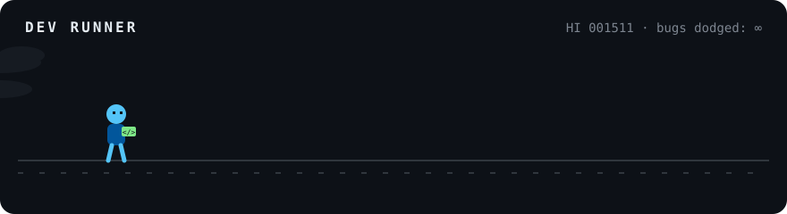

<div align="center">

# Hey, I'm Ketan 👋


<br/>



<sub>my average day, in one loop 🏃</sub>

</div>

---

```dart
final ketan = Developer(
  role: ['Flutter Developer', 'Backend Developer'],
  builds: ['cross-platform apps', 'real-time servers', 'REST & WebSocket APIs'],
  speaks: ['Dart', 'TypeScript', 'JavaScript', 'Python', 'Java', 'C++'],
  learning: ['distributed systems', 'AI agents'],
  funFact: 'I debug with music on loop 🎧',
);
```

## 🛠️ What I do

- 📱 **Flutter apps** for Android and the web, from a single codebase, with clean architecture and real tests
- ⚙️ **Backends** in Node.js / TypeScript: REST and WebSocket APIs, real-time features, caching and queues
- 🐳 **Shipping**: Docker, CI pipelines, and load tests before anything goes live
- 🧩 **Problem solving**: competitive programming on Codeforces and LeetCode

## 🧰 Toolbox

<p align="center">
  <br/>
  <br/>
  
</p>

## 🐍 My contributions, eaten by a snake

<picture>
  <source media="(prefers-color-scheme: dark)" srcset="https://raw.githubusercontent.com/Ketan-Verma21/Ketan-Verma21/output/github-snake-dark.svg" />
  <source media="(prefers-color-scheme: light)" srcset="https://raw.githubusercontent.com/Ketan-Verma21/Ketan-Verma21/output/github-snake.svg" />
  
</picture>

## 📊 Stats

<p align="center">
  
  
</p>
<p align="center">
  
</p>

## 🎧 Off the keyboard

Arctic Monkeys · Prateek Kuhad · anime OSTs on loop · football on weekends · *Code. Music. Coffee. Repeat.*

## 📫 Find me

<p align="center">
  <a href="https://www.linkedin.com/in/"></a>
  <a href="https://codeforces.com/profile/ketanverma1511"></a>
  <a href="https://leetcode.com/ketanverma1511/"></a>
  <a href="https://auth.geeksforgeeks.org/user/ketanver3277"></a>
  <a href="https://www.codingninjas.com/studio/profile/294ae999-7b2e-472c-9c13-3aeb8d6ac85f"></a>
  <a href="https://www.instagram.com/ketan_verma1511/"></a>
</p>

<p align="center"><sub>Thanks for scrolling — let's build something 💙</sub></p>
